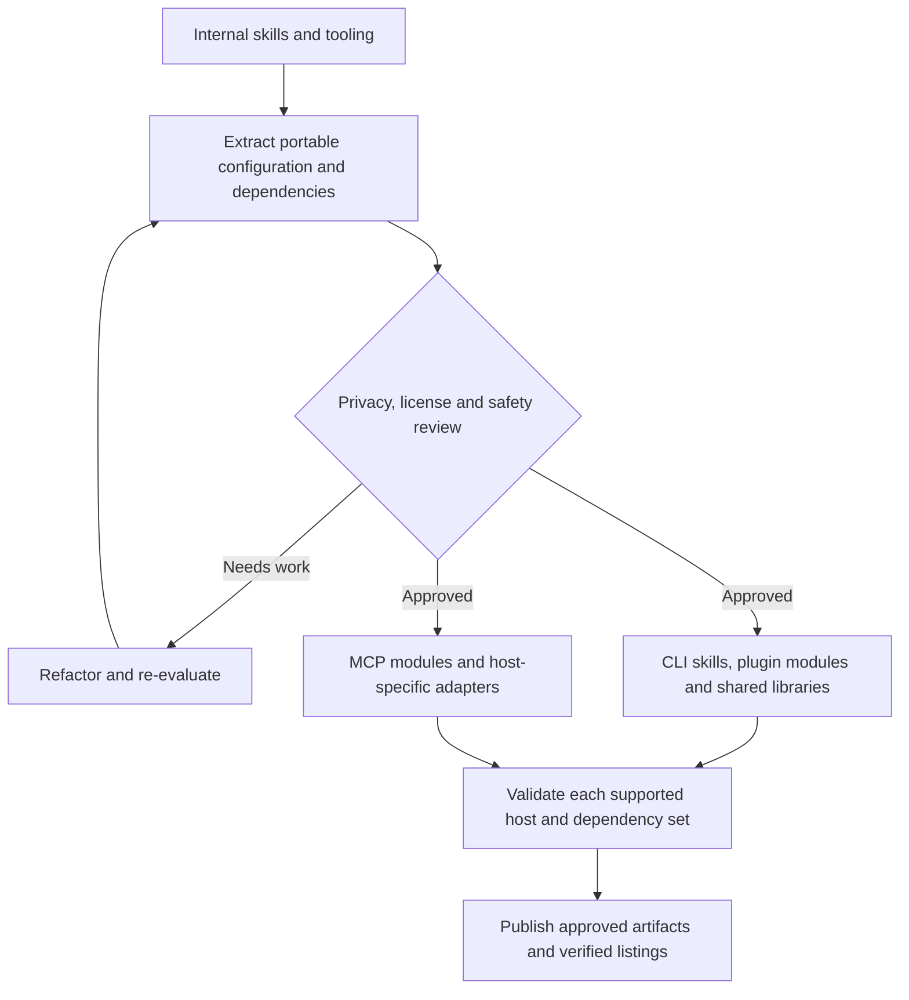

<!-- markdownlint-disable MD013 -->

# AI Harness public skills

A curated public catalog of portable Agent Skills for planning, documentation, repository work,
presentations, meetings, and day-to-day agent workflows. Install one skill at a time with
[GitHub's Agent Skills CLI](https://agentskills.io/specification), or browse the source before
deciding.

> **Provenance and maturity:** This repository is a generated public projection of a privately
> maintained canonical catalog. Only explicitly approved skills and their resolved dependencies
> are copied here. Publishing is active, but the catalog and preview installation tooling may
> continue to evolve. Each projection records its source revision and file digests in
> [`PUBLIC-PROJECTION-PROVENANCE.json`](PUBLIC-PROJECTION-PROVENANCE.json).

## Choose and install one skill

The primary supported path is [GitHub's Agent Skills CLI](https://agentskills.io/specification),
which discovers skills directly from this repository's `skills/*/SKILL.md` layout — no
marketplace registration step required:

```bash
gh skill install sergeiwallace/skills spec --agent claude-code --scope user
```

Invoke the installed skill literally in Claude Code:

```text
/spec describe how to add a health-check endpoint
```

`/spec` should return an implementation plan and wait for your approval before changing anything.
Replace `spec` with any name in the catalog below, and `--agent claude-code` with your own host
from `gh skill install --help` (Cursor, Codex, Gemini CLI, and many others are supported).

Preview a skill before installing it:

```bash
gh skill preview sergeiwallace/skills spec
```

### Install every skill as one Claude Code plugin

This repository is also a Claude Code plugin marketplace named `skills`, with one plugin, also
named `skills`, that carries every skill in the catalog. Install it from inside Claude Code
(version 2.1.275 or later):

```text
/plugin install skills --marketplace sergeiwallace/skills
```

Or from your shell:

```bash
claude plugin marketplace add sergeiwallace/skills
claude plugin install skills@skills
```

The plugin's version is the source commit recorded in
[`PUBLIC-PROJECTION-PROVENANCE.json`](PUBLIC-PROJECTION-PROVENANCE.json), so
`claude plugin update skills@skills` picks up each new projection.

### Other hosts

For other hosts, follow the host's own [Agent Skills](https://agentskills.io/specification)
installation instructions and review the skill's requirements first. Some skills use repository-level shared packages or
assets, so copying only a `skills/<name>/` directory is not a universal installation method.

## Included skills

The descriptions below come from each skill's `SKILL.md` frontmatter. Every public skill is licensed
under Apache-2.0; requirements are shown only when they materially affect use.

<!-- GENERATED:CATALOG:START -->

| Skill | Description | Requirements | Install |
| --- | --- | --- | --- |
| [`clean-task-panel`](skills/clean-task-panel/) | Remove all completed tasks from the CC TUI task panel. | Claude Code task-panel tools | `gh skill install sergeiwallace/skills clean-task-panel --agent claude-code --scope user` |
| [`explain`](skills/explain/) | Build a grounded mental model of a design or plan document, issue, code target, or technical concept. Use for explanation, refresher, rationale, comparison, trace, consequence, or learning-mode requests where faithful relationships matter more than compression. | — | `gh skill install sergeiwallace/skills explain --agent claude-code --scope user` |
| [`graphic`](skills/graphic/) | Provider-neutral pipeline for small graphic assets (icons, favicons, simple marks) — inspect/brief, route to reuse or constrained SVG primitives, sanitize+normalize through an SVG allowlist and SVGO, render a contact sheet, and gate on human selection before packaging. Phase one only; vector generation, tracing, and raster generation are deliberately out of scope. | Node.js and npm | `gh skill install sergeiwallace/skills graphic --agent claude-code --scope user` |
| [`jira`](skills/jira/) | Jira operations — create issues, search, update, link, comment, sprint overview | Jira MCP connector and access | `gh skill install sergeiwallace/skills jira --agent claude-code --scope user` |
| [`meeting-analysis`](skills/meeting-analysis/) | Turn a meeting's sources (recording, vendor transcript, notes export, chat) into a template-conformant analysis doc, either from a zip or directory you give it or, with --retrieve, by first landing a named Microsoft Teams meeting's artefacts through the teams skill. Cross-checks the vendor transcript against an independent local ASR pass to recover mangled product names, reads screen-share frames natively, consolidates every action item, and records what did not work. Use for "analyze this meeting", "write up the standup" or "retrieve and analyze today's stand-up". | `ffmpeg`, `ffprobe`, and `pdftotext`; `uv` | `gh skill install sergeiwallace/skills meeting-analysis --agent claude-code --scope user` |
| [`presentation`](skills/presentation/) | Author a local, review-gated Slidev presentation from a normalized event brief and optional research. | Node.js, npm, and Python 3 | `gh skill install sergeiwallace/skills presentation --agent claude-code --scope user` |
| [`report-feedback`](skills/report-feedback/) | Prepare privacy-scoped bug reports or feature requests for public GitHub and authenticated Claude Code feedback, with an explicit human gate before any GitHub write. | `uv`; `gh` for the optional GitHub route | `gh skill install sergeiwallace/skills report-feedback --agent claude-code --scope user` |
| [`research-doc`](skills/research-doc/) | Write a self-contained, template-conformant research document with Chain-of-Verification grounding, adversarial review, live citation validation, a provenance ledger, and claim-tier tags. Use for a scoped "research X and write it up" request, inline or through an installation-provided research adapter. | `uv` and a live research/fetch capability | `gh skill install sergeiwallace/skills research-doc --agent claude-code --scope user` |
| [`spec`](skills/spec/) | Present an implementation plan for review before making changes | — | `gh skill install sergeiwallace/skills spec --agent claude-code --scope user` |
| [`summarize`](skills/summarize/) | Faithfully compress caller-selected documents, issues, code, topic packets, or explicit session batches for a declared reader and purpose. | — | `gh skill install sergeiwallace/skills summarize --agent claude-code --scope user` |
| [`sync-git`](skills/sync-git/) | Safely synchronize safe uncommitted work and local/remote branch state across selected repositories and worktrees; discard and gitignore recommendations always require human approval. | Git and `uv` | `gh skill install sergeiwallace/skills sync-git --agent claude-code --scope user` |
| [`teams`](skills/teams/) | Read Microsoft Teams chats, meeting threads, transcripts (.vtt), recordings and Loop notes with the Teams web client's own tokens from a token provider you plug in, land a named meeting's artefacts (the latest, or a date and time) in a dated folder from a named-meetings config, read a meeting Recap's AI summary from a Teams tab you keep open, and send a Teams message only after you approve its exact text and destination. Use for "read the team chat", "get the stand-up transcript" or "download the meeting recording and notes". | `uv`; a Teams token broker; Chromium for the PDF and Recap steps | `gh skill install sergeiwallace/skills teams --agent claude-code --scope user` |
| [`teams-message-draft`](skills/teams-message-draft/) | Draft or revise a Microsoft Teams message in the user's own voice, in a rolling drafts doc per project, after reading the doc's voice guide and every AI-draft-versus-sent comparison in full. When the user says they sent a message, ask for a screenshot, transcribe it, write down what changed and grow the voice guide with citations; a script then archives the sent or dropped entry and validates the doc. Drafts into a file only and never posts. Use for "draft a Teams reply to the review thread" or "I sent the release note, here is the screenshot". | Python 3.11+ and Git | `gh skill install sergeiwallace/skills teams-message-draft --agent claude-code --scope user` |

<!-- GENERATED:CATALOG:END -->

## Roadmap: modular skills, CLI tools, and MCP servers

This public catalog is a curated subset of a larger working toolkit. The roadmap is to refactor
and sanitize useful skills developed, adapted, or curated for that toolkit, extract reusable CLI libraries, and group
related workflows into cohesive plugin modules. Where a stable tool interface is useful, focused
MCP servers can expose the same underlying libraries instead of duplicating behavior in prompts.

This is a direction, not a release schedule. The proposed release workflow is:



The branches describe possible packaging paths, not modules or host support already released.

The tables below list **one candidate skill per row**, grouped by workflow. These categories are
not published plugin names. **Internal; packaging pending** means an implementation exists in
the private toolkit, but portability work, public review, and public packaging remain. It does
not mean every feature is complete or validated across every host. Only skills listed in the
[public catalog above](#included-skills) are installable from this repository today; those
already-public skills are not repeated here.

The toolkit also includes upstream work. `grill-me` and `grilling` are vendored from
[Matt Pocock's skills](https://github.com/mattpocock/skills) under MIT, and `archify` is an
upstream MIT skill credited to `tt-a1i`. Their rows describe possible packaging here, not
original authorship or an unreleased upstream project. Retired skills are excluded.

### Implementation, reviews, and release readiness

| Skill | Purpose | Release status |
| --- | --- | --- |
| `implement` | Carry a change through research, test-driven development, implementation, cross-review, checks, and acceptance verification. | Internal; packaging pending |
| `bug-fix` | Reproduce a defect, establish its root cause and failing regression test, then fix and verify it. | Internal; packaging pending |
| `review` | Review uncommitted changes with a separate model family and configurable review depth. | Internal; packaging pending |
| `audit-auto` | Prepare and run a scoped audit autonomously, then incorporate findings and resolve in-scope decisions. | Internal; packaging pending |
| `audit-review` | Prepare an audit brief for human approval before running the audit and incorporating findings. | Internal; packaging pending |
| `release-prep` | Check release readiness against repository evidence and stop when required proof is missing. | Internal; packaging pending |

### Delegation, orchestration, and autonomous goals

| Skill | Purpose | Release status |
| --- | --- | --- |
| `delegate` | Build a bounded delegation brief, select the worker and execution settings, launch work, and collect results. | Internal; packaging pending |
| `codex` | Delegate a well-scoped task to Codex and report the result. | Internal; packaging pending |
| `handoff` | Transfer scoped work and context to another session working on an independent project or file set. | Internal; packaging pending |
| `orchestrate` | Prepare and launch a coordinator with explicit isolation, integration, and parallel-worker limits. | Internal; packaging pending |
| `auto-flow` | Drive a configurable research, documentation, implementation, and audit pipeline from validated workflow state. | Internal; packaging pending |
| `draft-goal` | Turn a raw request into validated standing-goal documents without starting the goal. | Internal; packaging pending |
| `start-goal` | Start a session goal from a template or drafted goal and verify that the session received it. | Internal; packaging pending |
| `exit-goal` | Report why an autonomous run cannot finish, what remains, and which blockers or decisions need attention. | Internal; packaging pending |

### Task planning, progress, and panel hygiene

| Skill | Purpose | Release status |
| --- | --- | --- |
| `beads-task` | Create a durable Beads work item together with its session task-panel mirror. | Internal; packaging pending |
| `track` | Turn untracked work from the conversation or repository into an issue in its owning project. | Internal; packaging pending |
| `next` | Identify current priorities, work that can proceed autonomously, and reviews that would unblock progress. | Internal; packaging pending |
| `progress-review` | Reconcile live session tasks with durable issues and produce an evidence-backed progress briefing. | Internal; packaging pending |
| `summary` | Write an end-of-batch retrospective connecting the original request, completed work, decisions, and next actions. | Internal; packaging pending |
| `load-task-panel` | Restore open session tasks to the Claude Code task panel. | Internal; packaging pending |
| `curate-task-panel` | Reconcile an existing task panel with evidence and propose bounded cleanup and issue dispositions. | Internal; packaging pending |
| `pr-badge-hygiene` | Remove a session's confirmed closed pull-request links from the Agents panel. | Internal; packaging pending |

### Session continuity and durable context

| Skill | Purpose | Release status |
| --- | --- | --- |
| `save-state` | Capture working state in memory and documents before compaction or context loss. | Internal; packaging pending |
| `auto-start` | Reconstruct the pre-compaction plan, resume authorized work, and surface remaining review items. | Internal; packaging pending |
| `persist` | Record permanent rules, decisions, and conventions in the appropriate context or procedure files. | Internal; packaging pending |
| `truncate-check` | Compare submitted prompt text with transcript and composer evidence to investigate suspected truncation. | Internal; packaging pending |

### Documentation, decisions, and human review

| Skill | Purpose | Release status |
| --- | --- | --- |
| `doc` | Scaffold and author a standard document type from a live template registry, interactively or automatically. | Internal; packaging pending |
| `decision-framework` | Resolve document decisions through a consistent authoring or review procedure. | Internal; packaging pending |
| `format-decision` | Present a decision's context, options, recommendation, and relationship to the work it serves. | Internal; packaging pending |
| `escalate-decision` | Package a blocked decision with its evidence and route it to an appropriately authorized reviewer. | Internal; packaging pending |
| `held-doc-review` | Compile current progress, batch outcomes, blockers, and escalated decisions into one review document. | Internal; packaging pending |
| `to-review` | Surface the documents and decisions a person must review to unblock waiting work. | Internal; packaging pending |
| `grill-me` | Provide an explicit entry point to the upstream plan-and-design interview workflow. | Upstream MIT; packaging pending |
| `grilling` | Stress-test a plan, decision, or idea through structured rounds of questions and a decision tree. | Upstream MIT; packaging pending |
| `archify` | Create explorable architecture and workflow diagrams or a self-contained visual explainer from requirements or repository evidence. | Upstream MIT; packaging pending |

### Git integration and worktree lifecycle

| Skill | Purpose | Release status |
| --- | --- | --- |
| `commit` | Create a commit through a provenance-validated authoring procedure. | Internal; packaging pending |
| `merge` | Land a finished change under the repository's rules, verify integration, synchronize worktrees, and close related work. | Internal; packaging pending |
| `pull-git` | Fast-forward selected repositories and worktrees only where the available evidence shows it is safe. | Internal; packaging pending |
| `git-review` | Review repository and worktree state, integrate ready changes, and identify provably redundant residue. | Internal; packaging pending |
| `reap-worktree` | Retire named stale, merged, or superseded worktrees only with the required evidence and safety checks. | Internal; packaging pending |

### Fleet coordination and messaging

| Skill | Purpose | Release status |
| --- | --- | --- |
| `chief-of-staff` | Coordinate registered sessions across machines, track acknowledgements and progress, and surface blockers. | Internal; packaging pending |
| `fleet-brief` | Produce a read-only fleet briefing covering session activity, progress, blockers, and decisions needing attention. | Internal; packaging pending |
| `message-board` | Coordinate a cross-machine handoff through a fallback message board when native session messaging cannot reach the recipient. | Internal; packaging pending |
| `git-inbox-take` | Accept durable work handed off through a Git-backed inbox and publish a receipt for the sender. | Internal; packaging pending |
| `upload-screenshot` | File a screenshot in the appropriate shared workspace collection and notify the session that needs it. | Internal; packaging pending |

### Browser automation and credential workflows

| Skill | Purpose | Release status |
| --- | --- | --- |
| `cdp-automation` | Route browser automation to reusable Chrome DevTools Protocol procedures and environment-specific setup. | Internal; packaging pending |
| `authenticate` | Check service authentication, route configured renewals, and diagnose failed credential channels. | Internal; packaging pending |
| `secret-handoff` | Prepare an owner-executed secret-store handoff using variable names and recipes without exposing the secret value to the agent. | Internal; packaging pending |

### Usage visibility, templates, and harness maintenance

| Skill | Purpose | Release status |
| --- | --- | --- |
| `usage-status` | Report available context-window and provider-quota observations, including known reset times. | Internal; packaging pending |
| `api-spend` | Estimate API spend from locally available transcript usage, with the estimate clearly labeled. | Internal; packaging pending |
| `codex-usage-reset` | Inspect weekly usage and preview a banked reset; redeem a credit only when configured thresholds and authorization permit it. | Internal; packaging pending |
| `copier-propagate` | Update shared project templates and propagate approved changes across consuming repositories. | Internal; packaging pending |
| `harness-update` | Update agent context in an isolated worktree, validate and integrate it, and hand off installation when needed. | Internal; packaging pending |
| `install-harness` | Compile, size-check, and install shared context artifacts while preserving traceability. | Internal; packaging pending |

### MCP servers and shared tooling

These are supporting tools and libraries, not additional skill names. Public source availability
does not imply a separately released package or an MCP registry listing.

| Tooling | Purpose | Release status |
| --- | --- | --- |
| Harness diagnostics MCP server | Expose bounded configuration validation, explanation, planning, and diagnostics through `harness_validate`, `harness_explain`, `harness_plan`, and `harness_doctor`. | Internal runtime; public module packaging pending |
| Beads MCP server | Expose structured issue reads and guarded mutations through shared task-management checks. | Internal runtime; public module packaging pending |
| Messaging adapters | Connect native session messaging and cross-machine transports for durable handoffs and coordination. | Internal; public module packaging pending |
| [`skill-cli-foundation`](packages/skill-cli-foundation/) | Share argument handling and CLI foundations across skills and tools. | Public source; broader packaging planned |
| [`meeting-retrieve`](packages/meeting-retrieve/) | Provide the shared meeting-retrieval dependency used by the public Teams workflow. | Public source; broader packaging planned |
| Authority, checkpoint, and runner contracts | Share explicit authority boundaries, resumable checkpoints, and execution contracts. | Internal; public package review pending |
| Task-state, repository-evidence, and usage-observation libraries | Normalize durable task state, read-only repository evidence, and provider usage observations. | Internal; public package review pending |
| Ask-fidelity and workflow resolvers | Validate request traceability and resolve audit targets and document modes consistently across workflows. | Internal; public package review pending |

### Packaging and distribution

The current public installation options are individual skills and the all-in-one Claude Code
plugin documented above. The next packaging direction is selective, cohesive plugin modules
backed by shared CLI libraries, with focused MCP servers where they add value. The module
boundaries, package names, and release order are still being worked out.

Each public module needs portable configuration, explicit dependencies and permissions,
license/provenance review, private-reference and secret checks, and relevant tests and evals.
The distribution goal is Claude Code plugin marketplaces and other appropriate skill, package,
or MCP registries. Additional registry listings and any official marketplace acceptance are
future work, not current availability claims.

### Host adaptations

Development is centered on CLI-based workflows, especially Claude Code and Codex. Further
adaptations are planned or exploratory for Claude Desktop and web, ChatGPT desktop and web,
Gemini / Antigravity, pi, and other compatible agent hosts.

A shared skill format does not imply feature parity: local command execution, hooks, task
panels, browser access, and MCP transports differ by host. Each adaptation will need its own
capability mapping and validation; the roadmap is not a claim that the internal toolkit already
works unchanged in those environments.

## How skills work

Each skill is a directory centered on a `SKILL.md` file, with optional scripts, templates,
references, and assets beside it. The [Agent Skills specification](https://agentskills.io/specification)
defines the portable structure and metadata that `gh skill install` and other Agent
Skills-compatible tooling discover automatically. A skill with repository-level shared package
dependencies (see [`packages/`](packages/)) resolves them as part of its own closure — install
the skill itself rather than copying files by hand.

Skill instructions do not override your responsibility to review proposed commands, file access,
network access, credentials, or external writes. Host support also does not imply that every
optional external tool used by every skill is installed.

## Trust and safety

**Curated does not mean guaranteed safe.** Skills can contain instructions and executable scripts,
and dependencies can change risk. Before installation, inspect the linked skill directory and its
generated plugin, confirm that you trust this repository and the recorded source revision, and
check requested tools and permissions. Use least-privilege credentials and keep secrets out of
prompts, fixtures, issue bodies, logs, and generated artifacts.

Public candidates are reviewed for portability, private references, dependency closure, license
consistency, executable content, secrets, compatibility, and relevant evals before projection.
Those gates reduce known risks; they are not a security certification. The authoritative projection
record is [`PUBLIC-PROJECTION-PROVENANCE.json`](PUBLIC-PROJECTION-PROVENANCE.json), and each
generated plugin carries its own `RELEASE-PROVENANCE.json`.

For a suspected vulnerability or malicious skill, use GitHub's private
[security advisory flow](https://github.com/sergeiwallace/skills/security/advisories/new). Do not
disclose sensitive details in a public issue.

## Contributing

This public repository is a generated projection, so a direct edit to projected skill content may
be overwritten. For a new skill, behavioral change, or catalog correction, open a
[public proposal](https://github.com/sergeiwallace/skills/issues/new) describing the use case,
portable behavior, requirements, and license/provenance.

Maintainers review accepted changes in the private canonical source, add eligible skills to the
private `public-candidates.toml` allowlist, run the portability, licensing, security, secret,
dependency, and eval gates, and then regenerate this repository. Public eligibility is an explicit
review decision; adding a folder or opening a proposal does not add it to the catalog automatically.

Use the [issue tracker](https://github.com/sergeiwallace/skills/issues) for ordinary bugs and
questions. Security reports follow the private route above.

## License

Apache License 2.0 for the projected skill content, code, and generated plugins. See
[LICENSE](LICENSE) and [NOTICE](NOTICE). Source revisions, dependency closure, and file digests are
recorded in [`PUBLIC-PROJECTION-PROVENANCE.json`](PUBLIC-PROJECTION-PROVENANCE.json).
